<div align="center">




[](https://www.linkedin.com/in/umair-khyam/)

</div>

## 🌑 About Me

Full-stack developer building web apps end to end — Next.js on the front, NestJS on the back, Postgres or MongoDB underneath.

## 🛸 Tech Arsenal

<p align="center">
  
</p>


## ☄️ GitHub Constellation Stats

<div align="center">
  
  
</div>

<div align="center">
  
</div>

<picture>
  <source media="(prefers-color-scheme: dark)" srcset="https://raw.githubusercontent.com/spacewitch123/spacewitch123/output/snake-dark.svg?v=gold"/>
  <source media="(prefers-color-scheme: light)" srcset="https://raw.githubusercontent.com/spacewitch123/spacewitch123/output/snake-light.svg?v=gold"/>
  
</picture>

<details>
<summary>🚀 <strong>Current Mission</strong> 🚀</summary>
<br/>

```typescript
const spacewitch = {
  building: "TODO: the actual app you're working on right now",
  learning: "Advanced TypeScript patterns & system design",
  focus: ["Full-stack development", "Clean, typed APIs"],
};

// Always exploring the intersection of creativity and code ✨
```

</details>

<div align="center">
  
</div>


